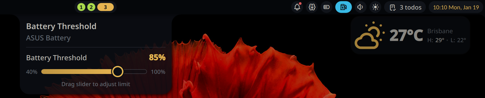

# Battery Threshold

A plugin for Noctalia Shell to control the battery threshold on laptops, helping
extend battery lifespan. This plugin only works if your laptop supports charge
threshold control (as exported by the kernel in sysfs). The plugin looks like
this in action:



## Features

- **Bar Widget**: Opens the selected battery's threshold panel
- **Panel**: Adjust battery threshold with a slider (40-100%)
- **Persistent Settings**: Saves and restores threshold across reboots

## Usage

Add the bar widget to your bar. Click to open the panel and adjust the battery
threshold using the slider.

### Panel Controls

- Drag the slider to set battery threshold (40-100%)
- Changes are applied immediately
- Settings persist across reboots

### Configuration and shared hardware

Settings opened for a placement edit that instance's battery selection. Settings
-> Plugins edits the plugin-level configuration, which instances inherit until
they override it. Reset removes that override instead of copying a default.

The physical charge limit belongs to the selected battery, not to a widget. All
views of the same battery observe the same current limit. A configuration's saved
limit is restored once when its Main-owned client activates, or after accepted
Settings Apply. Conflicting saved limits can therefore change the same battery
in activation order; no client continually reasserts its limit. Additional views
of an already active configuration do not restore it again.

Moving the panel slider immediately changes its captured battery and then saves
the limit through that panel's own runtime preference owner. A failed physical
write does not save the preference. A failed preference save does not undo a
successful physical write. Retired contexts cannot save delayed action results
into another configuration. Main/IPC commands remain explicitly plugin-level.

## Setup (Required)

This plugin requires write access to the battery threshold sysfs file. The
included `setup_rules.sh` script configures an udev rule that grants write
permission to members of the `battery_ctl` group:

```bash
$ sudo ./setup_rules.sh
```

This script will:

- Create a `battery_ctl` group (if it doesn't exist)
- Add your user to the `battery_ctl` group
- Install the udev rule to `/etc/udev/rules.d/`
- Reload udev rules

**Note:** A reboot may be required for write access to take effect.

## IPC Commands

```bash
# Toggle panel
qs -c noctalia-shell ipc call plugin:battery-threshold togglePanel

# Set threshold
qs -c noctalia-shell ipc call plugin:battery-threshold set <value>
```

## Troubleshooting

- **Read-only mode**: Ensure udev rule is installed, and you're in the correct
  group
- **Not available**: Your laptop may not support charge threshold control, or
  select the correct battery in the settings menu
- **Changes not saving**: Check write permissions on the sysfs file

## Requirements

- Laptop with battery charge threshold support (ThinkPad, ASUS, etc.)
- Noctalia 3.6.0 or later
- Tested on Asus Zenbook 14 UX3405
- Tested on Asus TUF Gaming F15 FX506L
